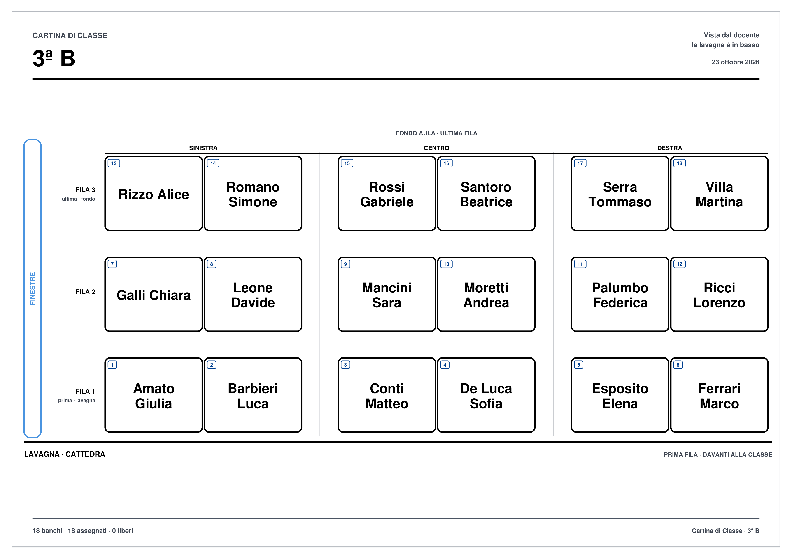

# Guida completa

> Questa è la guida dettagliata. Per scaricare e iniziare, leggi il [README](README.md).

Cartina dei posti di una classe pensata per docenti ipovedenti. Gira bene su una chiavetta USB, non richiede installazioni e non invia dati.

Il progetto offre **tre modi** per usarla:

| Versione | File | Quando conviene |
| --- | --- | --- |
| **Online** (GitHub Pages) | [Apri l'app](https://Gab2412.github.io/Mappatura_classi/) | Nessuna installazione: apri la pagina, scegli la cartella e lavora. |
| **HTML portatile** | `Cartina-di-Classe.html` | Un solo file da portare su una chiavetta o su un computer senza Python. |
| **App desktop** | `CartinaDiClasse.exe` | Windows: finestra propria e cartella `files` creata accanto all'app. |

I file pubblicati sono in `docs/` (`app.html`, `CartinaDiClasse.exe`, modello Excel). Chi compila il progetto li trova in `dist/`.



---

## Guida rapida

1. **+ Nuova classe** e segui la procedura guidata: nome → aula → alunni.
2. **Disponi nei banchi**: l'app riempie i banchi liberi in ordine alfabetico.
3. **Immagine chiara** (stampa) o **Immagine scura** (schermo): il PNG finisce nella cartella `Esportazioni`.

Tutto il resto è facoltativo: per correggere un posto basta cliccare o toccare il banco sulla mappa.

---

## App desktop

### Requisiti

- Windows 10 o 11 a 64 bit.
- **WebView2**: è già presente in Windows 11 e in quasi tutti i Windows 10 aggiornati. Se manca, Windows lo propone una volta con un aggiornamento gratuito di Microsoft Edge.
- Nessuna installazione dell'app: è un singolo file `.exe`. Per passare il programma a un collega basta il solo **`CartinaDiClasse.exe`**: crea da sé la sua cartella `files` e il modello Excel.

### Primo avvio

1. Copia `CartinaDiClasse.exe` in una cartella, anche su una chiavetta USB.
2. Fai **doppio clic**. Il primo avvio richiede qualche secondo.
3. Accanto all'eseguibile nasce la cartella **`files`**: lì vivono tutte le tue classi.

Se sposti l'eseguibile, porta con sé anche la cartella `files` per ritrovare le classi. Se hai usato una versione precedente, al primo avvio le classi della vecchia cartella `CartinaClassi` vengono copiate in `files` (la vecchia cartella non viene toccata).

### La schermata iniziale: **Le mie classi**

Vedrai l'elenco di tutte le classi, con nome, numero di alunni, banchi e data dell'ultima modifica.

- **+ Nuova classe** (verde): avvia la **procedura guidata in 3 passi** (nome, aula, alunni) e apre subito la classe. Con poche classi si apre anche dal riquadro vuoto come **Crea la prima classe**.
- **Apri** (blu): apre la classe.
- **Rinomina** (ambra): cambia il nome mostrato.
- **Duplica** (grigio): crea una copia completa, utile a inizio anno.
- **Elimina** (rosso): sposta la classe in `files\Cestino`, da dove puoi recuperarla.
- **Apri file…**: importa nella cartella una classe `.json` ricevuta da altri.
- **Apri la cartella delle classi**: apre Esplora file sul contenuto.

### Nuova classe guidata

1. **Nome**: come si chiama la classe (es. `1A`). Premi **Avanti** o **Invio**.
2. **Aula**: quante file e quante colonne, poi compila la tabella: in ogni cella scrivi **quanti banchi** ci sono (0 = spazio vuoto). Sotto la tabella vedi la **lavagna con la cattedra**, così capisci subito dove sei; la riga in alto è il fondo dell'aula. Se vuoi, indica anche **da che lato sono le finestre** (nessuna, a sinistra, a destra).
3. **Alunni**: incolla un nome per riga, oppure salta il passo e aggiungili dopo con **Aggiungi alunni**.

In ogni passo il riquadro **Indietro / Avanti / Crea la classe** mostra sempre dove sei (Passo 1, 2, 3).

### La schermata della classe

In alto ci sono pochi comandi grandi e colorati:

| Comando | Colore | Cosa fa |
| --- | --- | --- |
| **Aggiungi alunni** | verde | Apre la schermata degli alunni: un nome alla volta o un elenco incollato. |
| **Quanti banchi** | blu | Apre la sezione con file, colonne e banchi di ogni cella. |
| **Disponi nei banchi** | turchese | Riempie automaticamente i banchi liberi, in ordine alfabetico (A→Z). |
| **Modifica** | grigio | Mostra o nasconde il pannello e allarga la mappa. |
| **Immagine chiara** | viola | Immagine con sfondo bianco, per la stampa. |
| **Immagine scura** | indaco | Immagine con sfondo scuro, per lo schermo. |
| **Stampa** | ambra | Prepara un'immagine A4 orizzontale e apre la stampa di Windows. |
| **Rinomina** | ambra | Cambia il nome della classe. |
| **Annulla / Ripeti** (frecce ↶ ↷) | grigio | Torna indietro o rifà l'ultima modifica. |

Ogni pulsante ha un suggerimento: ferma il mouse sopra e leggi a cosa serve.

La mappa al centro mostra l'aula **vista dal docente**: la lavagna è in basso, davanti a te. Clicca un banco per assegnare o spostare un alunno.

Il pannello a destra ha due sezioni richiudibili: **Banchi** e **Alunni**. Restano nella stessa colonna senza scorrimenti orizzontali: i numeri dei banchi vanno a capo da soli. Sulla sinistra del pannello c'è una **maniglia**: trascinala (o usa le frecce ← → dopo averla selezionata) per allargare o stringere la colonna; la larghezza scelta viene ricordata.

### Inserire i banchi

Ogni numero indica **quanti banchi ci sono in un gruppo**. Il valore `0` lascia uno spazio vuoto.

- **File / Colonne**: imposta la dimensione dell'aula e premi **Applica**.
- **Tabella dei banchi**: usa `−` e `+` per cambiare il numero in ogni cella.
- **Finestre**: indica se sono a sinistra, a destra o se non ci sono. Il lato scelto si vede sul bordo della mappa e nell'immagine esportata, così riconosci subito l'aula.
- **Inserimento rapido**: scrivi una riga per ogni fila. I numeri si separano con spazi, virgole o `/`.

Esempio: `2,3,2 / 2,2,2 / 2,2,1` significa

```
ultima fila (fondo aula)  2 3 2
fila centrale             2 2 2
prima fila (lavagna)      2 2 1
```

cioè tre banchi al centro dell'ultima fila e un solo banco a destra nella prima fila.

**Come orientarsi**

- La **prima riga in alto è l'ultima fila**, il fondo dell'aula.
- L'**ultima riga in basso è la prima fila**, vicino alla lavagna.
- I posti sono numerati **dalla prima fila, da sinistra a destra, fila per fila**.

### Inserire gli alunni

Il pulsante **Aggiungi alunni** apre una schermata dedicata:

- scrivi **Nome e cognome** e premi **Aggiungi** (o **Invio**): l'alunno entra nell'elenco e il campo si svuota, pronto per il successivo;
- sotto vedi l'elenco di quelli appena aggiunti, con il totale aggiornato;
- l'elenco degli alunni è sempre in **ordine alfabetico**, anche se scrivi o incolli i nomi in disordine;
- se scrivi un nome già presente, l'app te lo segnala e non lo duplica;
- **Aggiungi più nomi insieme**: apri la tendina e incolla un elenco, un nome per riga;
- **Importa da Excel/CSV…** porta dentro anche la disposizione dei banchi.

Nella tabella degli alunni (sezione **Alunni** del pannello):

- **Assegna a un posto…** sposta un alunno in un banco preciso; **Rinomina o rimuovi** cambia il suo nome senza spostarlo, oppure lo toglie dall'elenco liberando il banco.
- Per cambiare un posto puoi anche cliccare direttamente il banco sulla mappa.
- **Cliccando un banco libero** puoi scegliere un alunno dall'elenco **oppure scrivere subito un nome nuovo**: premi **Assegna** (o **Invio**) e l'alunno viene creato e seduto in quel posto. Il pulsante **Assegna** fa tutto: se non hai scelto nessuno ma hai scritto un nome, crea l'alunno; se non c'è né scelta né nome te lo segnala in rosso.
- Se sposti un alunno in un banco occupato, i due si scambiano di posto.
- **Disponi nei banchi** (in alto) riempie da solo tutti i banchi liberi in ordine alfabetico.
- La casella **Cerca un alunno** filtra l'elenco. L'elenco è **sempre in ordine alfabetico** (A→Z), anche se i nomi vengono inseriti in disordine: l'ordine non cambia i posti già assegnati.

### Importare da Excel o CSV

Premi **Importa da Excel/CSV…** e scegli il file. L'app mostra cosa ha trovato prima di applicarlo, con i pulsanti:

- **Sostituisci tutto**: applica disposizione e alunni.
- **Aggiungi solo gli alunni**: aggiunge i nomi a quelli già presenti, senza toccare la disposizione.
- **Scarica modello Excel**: salva nella cartella `Esportazioni` un modello pronto da compilare.

Il modello contiene tre fogli:

| Foglio | Cosa contiene |
| --- | --- |
| `Istruzioni` | Spiegazioni e esempio, viene ignorato durante l'importazione. |
| `Layout` | La disposizione dei banchi: numeri da 0 a 12, come nella tabella dell'app. |
| `Alunni` | Un nome per riga e, se vuoi, il posto con le colonne `Fila`, `Colonna`, `Banco`. |

Nel foglio `Alunni`:

- **Fila 1** = prima fila, vicino alla lavagna.
- **Colonna 1** = sinistra, vista dal docente.
- **Banco 1** = primo banco del gruppo, da sinistra.
- Se lasci vuoto il posto, l'alunno viene sistemato automaticamente nel primo banco libero.
- La colonna `Alunno` è obbligatoria; le altre sono facoltative.

Se Excel non viene letto, salva il foglio come **CSV UTF-8** e importa il CSV: l'app riconosce da sola il separatore (virgola, punto e virgola o tab).

### Immagini, stampa e file esportati

- **Immagine chiara**: sfondo bianco, pensata per la stampa.
- **Immagine scura**: sfondo scuro, pensata per lo schermo.
- **Stampa**: prepara un foglio **A4 orizzontale** e apre la stampa di Windows.

In tutti i formati la planimetria è **centrata nel foglio**: il gruppo di banchi con le etichette delle file e la lavagna sta al centro, non più appoggiato in basso a sinistra.

Subito dopo l'esportazione compare un riquadro con il nome del file e due pulsanti: **Apri immagine** la mostra subito, **Apri cartella** apre `files\Esportazioni`.

Di default l'immagine **si adatta al disegno**: se l'aula è larga e bassa, il PNG è largo e basso, senza grandi margini vuoti. Se ti serve un foglio A4 (per esempio per un raccoglitore), scegli **Foglio A4 orizzontale** in **Impostazioni → Formato delle immagini**.

Nelle **Impostazioni** scegli anche la qualità dei PNG: 150, 300 o 600 DPI.

### Impostazioni

Le modifiche si vedono subito e vengono ricordate nel file `files\impostazioni.json`.

- **Tema**: automatico (segue il sistema), chiaro o scuro.
- **Dimensione del testo**: da 16 a 32 pixel; ingrandisce anche la mappa.
- **Numero del posto** e **banchi vuoti**: mostra o nasconde questi dettagli.
- **Nomi visualizzati**: nome e cognome, solo nome, solo cognome o iniziali.
- **Formato delle immagini**: adattata al disegno (default, per lo schermo) oppure foglio A4 orizzontale (per la stampa).
- **Qualità delle immagini**: 150, 300 o 600 DPI.
- Collegamenti rapidi a **cartella classi**, **cartella esportazioni** e **registro diagnostico** (utile in caso di problemi).

### Dove sono i file

```
files\
  <classe>.json       un file per ogni classe, direttamente nella cartella
  Esportazioni\       immagini PNG, modelli e file di stampa
  Cestino\            classi eliminate, recuperabili
  impostazioni.json   tema, dimensione testo e preferenze
  diagnostica.log     registro delle operazioni e degli errori
```

Per fare un **backup** o passare a un altro computer, copia tutta la cartella `files`. Su macOS e Linux i separatori sono `/`; il contenuto della cartella è lo stesso.

### Accessibilità

- Testi grandi, regolabili da 16 a 32 pixel; layout lineare con poche sezioni.
- Tema scuro ad alto contrasto, oppure chiaro.
- Pulsanti grandi e colorati per funzione (verde = aggiungi, blu = imposta, turchese = disponi nei banchi, ambra = stampa/rinomina, rosso = elimina, viola/indaco = esporta).
- Tutti i comandi sono raggiungibili con **Tab**; i banchi si esplorano con le **frecce** e si aprono con **Invio** o **Spazio**.
- Ogni azione importante viene annunciata da una **live region** e da un messaggio breve.
- Focus sempre ben visibile; nessun trascinamento obbligatorio.

**Scorciatoie da tastiera**

| Scorciatoia | Azione |
| --- | --- |
| `Ctrl+S` | Salva subito la classe |
| `Ctrl+Z` | Annulla |
| `Ctrl+Y` o `Ctrl+Shift+Z` | Ripeti |
| `Frecce` | Spostati tra i banchi |
| `Invio` / `Spazio` | Apri il banco selezionato |
| `Esc` | Chiude il dialogo aperto |
| `Ctrl` + rotella | Ingrandisce o riduce l'interfaccia |

### Salvataggio automatico

Non devi premere **Salva**: ogni modifica viene scritta nel file della classe poco dopo. In alto a destra vedi **Salvato · ora** oppure **Salvataggio…**. **Annulla** e **Ripeti** conservano le ultime modifiche.

---

## Versione HTML

La versione HTML è la **stessa applicazione** dell'exe: stessi pulsanti, stessa procedura guidata, stesse impostazioni. In più non richiede Python: apri `docs/app.html` (o il file `Cartina-di-Classe.html` scaricato) con **Chrome** o **Edge**, anche da una chiavetta USB.

### Primo avvio

1. Apri il file HTML con doppio clic, usando **Chrome** o **Edge**. Se usi la pagina online, apri il sito e premi **Apri l'app**.
2. Nella schermata iniziale leggi l'avviso **«Senza la cartella dei file l'app non può funzionare»**: finché non scegli la cartella non è possibile creare né aprire classi.
3. Premi **Scegli la cartella…** e scegli dove tenere i dati. Se apri il file HTML da una cartella, va bene quella; se usi la pagina online, va bene una cartella qualsiasi (per esempio `Documenti\Cartina`). L'app crea lì la sottocartella **`files`**.
4. Se preferisci, puoi selezionare direttamente una cartella già chiamata `files` (o che contiene già delle classi): viene usata così com'è.

Da quel momento le classi vengono salvate con gli stessi nomi e lo stesso formato dell'app desktop: `files\<classe>.json`, `files\Esportazioni`, `files\Cestino`, `files\impostazioni.json`.

Il browser ricorda la cartella: alle aperture successive basta un clic su **Riattiva l'accesso** per riprendere a leggere e scrivere. Se il file HTML e la cartella `files` vengono spostati insieme, i dati restano al loro posto.

> **Browser.** Per scegliere e scrivere in una cartella servono **Chrome** o **Edge**. Firefox e Safari non hanno questa funzione: l'app si apre, ma non può salvare i file in una cartella locale.

### Differenze dall'exe (solo dove il browser non arriva)

- **Scelta della cartella**: per sicurezza il browser richiede un clic; l'exe invece crea `files` da solo accanto a sé. Nella versione HTML, scelta la cartella del programma, `files` viene creata automaticamente al suo interno.
- **Stampa**: l'app prepara il PNG in `files\Esportazioni` e lo apre in una nuova scheda; premi **Ctrl+P** per stampare (puoi anche scegliere **Salva come PDF**).
- **Esplora file** e **registro diagnostico**: il browser non può aprirli; l'app mostra un messaggio che spiega dove sono. Apri la cartella `files` con Esplora file.

Per il resto l'interfaccia e il comportamento sono identici: nessun account, nessun cloud. L'app non invia dati e non carica risorse esterne; la pagina statica arriva da GitHub Pages, ma le classi restano nella cartella scelta.

---

## Per chi sviluppa

L'interfaccia e la logica vivono in **un solo posto**, `desktop/web/`, e vengono usate sia dall'exe sia dalla versione HTML. I moduli condivisi (`src/js`, `src/css`) vengono copiati in `desktop/web/vendor` prima di ogni build.

```
src/
  css/                  stili condivisi, temi e regole di stampa
  js/
    00-core.js          modello dati, layout, numerazione, assegnazioni
    05-template.js      modello Excel incorporato come base64 (generato)
    10-store.js         stato, annulla/ripeti, preferenze
    20-map.js           disegno della mappa a schermo
    30-editor.js        tabella dei banchi ed elenco alunni
    40-export.js        SVG, PNG, stampa e CSV
    50-import.js        lettore XLSX/CSV e modello Excel
desktop/
  app.py                backend Python (file, dialoghi, finestra)
  web/
    index.html          interfaccia unica (exe e HTML)
    css/app.css         stile dell'app
    js/app.js           logica dell'app, uguale nelle due versioni
    js/web-api.js       API dei file per il browser (File System Access)
    vendor/             copia dei moduli condivisi, rigenerata da scripts/
  icona.ico             icona dell'eseguibile
  CartinaDiClasse.spec  ricetta PyInstaller
  build.ps1             script di compilazione
  test_api.py           prova automatica dei metodi Python
assets/                 modello Excel di partenza
.github/workflows/      creazione automatica delle release
docs/                   sito pubblicato: landing, app.html, exe e immagini
dist/                   build locale (esclusa da Git)
scripts/                generazione modello, sincronizzazione e build
tests/                  test automatici del modello dati
README.md               pagina di presentazione del progetto
GUIDA.md                questa guida
```

### Compilare l'app desktop

Servono Node.js 18+, Python 3.14 e i pacchetti:

```bash
python -m pip install pywebview pythonnet pyinstaller pillow
```

Poi, dalla cartella principale:

```bash
powershell -ExecutionPolicy Bypass -File desktop\build.ps1
```

oppure i singoli passi:

```bash
node scripts/sync-desktop.mjs                  # copia i moduli condivisi
python desktop/make_icon.py                    # icona
python -m PyInstaller --noconfirm --clean desktop/CartinaDiClasse.spec
```

Il risultato è `dist/CartinaDiClasse.exe`; lo script aggiorna anche `docs/CartinaDiClasse.exe`, `docs/app.html` e il modello Excel nella cartella pubblicata.

Per provare l'interfaccia desktop senza compilare:

```bash
node scripts/sync-desktop.mjs   # crea desktop/web/vendor da src/
python desktop/app.py
```

Per fare solo l'anteprima nel browser (senza Python e senza file reali), avvia un server locale nella cartella `desktop/web` e apri `index.html?preview=1`: l'interfaccia usa dati di prova e non chiede la cartella. Senza `?preview=1`, Chrome/Edge chiedono la cartella `files` e salvano davvero.

### Compilare la versione HTML

```bash
node scripts/embed-template.mjs   # rigenera il modello Excel incorporato
node scripts/build.mjs            # crea dist/Cartina-di-Classe.html e docs/app.html
```

Il file generato è autoconsistente: CSS e script sono incorporati, nessuna risorsa esterna e nessun riferimento al cloud. `build.mjs` copia anche il modello Excel e, se esiste, l'exe in `docs/`, così la cartella pubblicata resta allineata.

### Pubblicare su GitHub Pages

La cartella pubblicata è `docs/`. Pages pubblica il branch `main`, cartella `/docs`; il file `.nojekyll` è già presente. La landing è [Gab2412.github.io/Mappatura_classi](https://Gab2412.github.io/Mappatura_classi/), l'app è su `/app.html`; l'exe e il modello Excel si scaricano dalla stessa pagina.

Le release sono create dal workflow `.github/workflows/release.yml` quando si pubblica un tag `v*`: allega l'exe, l'HTML e il modello Excel.

### Test

```bash
node --test tests/core.test.mjs   # test del modello dati
python desktop/test_api.py        # test dei metodi Python dell'app desktop
```

Per provare l'API dei file della versione HTML (cartella simulata in memoria) avvia un server nella cartella principale e apri `http://127.0.0.1:8000/tests/web-api.html`: deve comparire «TUTTI I CONTROLLI SUPERATI». Con `tests/web-api.html?parent=1` si verifica anche la creazione automatica della sottocartella `files` dentro la cartella scelta.

---

## Privacy

L'app non invia dati e non carica risorse esterne. Non ci sono account né servizi cloud: le classi restano nei file dentro la cartella `files`, accanto al programma. La pagina statica è ospitata da GitHub Pages, ma le classi non passano dal server: restano nella cartella scelta.

## Limiti

- Fino a 20 file e 12 colonne; da 0 a 12 banchi per cella; fino a 500 alunni.
- I file Excel in formato ZIP64 non sono supportati: in quel caso salva come CSV UTF-8.
- La stampa usa sempre il tema chiaro in A4 orizzontale.
