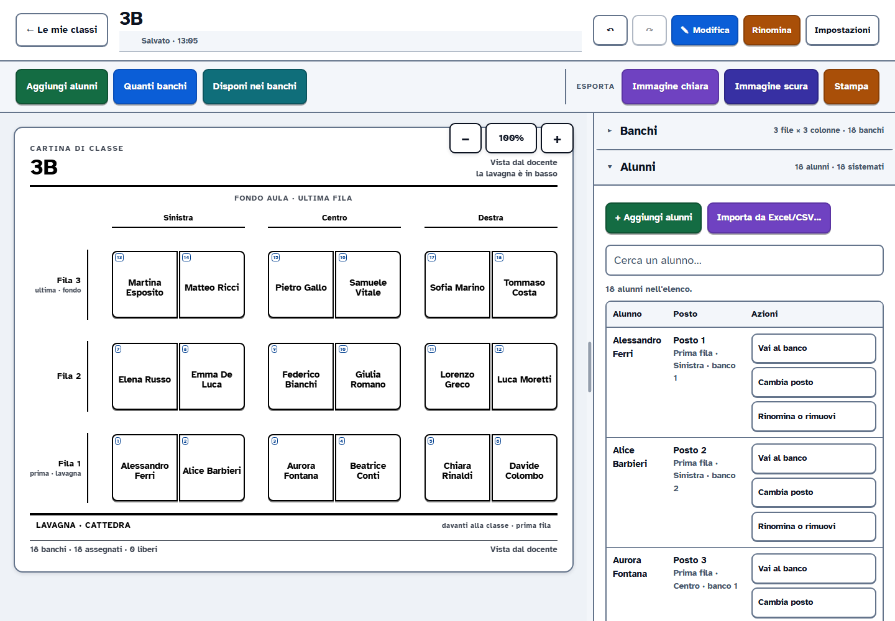

<p align="center">
  
</p>

<h1 align="center">Cartina di Classe</h1>

<p align="center">
  <strong>La pianta dei posti, senza cloud.</strong><br>
  Crea la cartina, sistema gli alunni e stampa.<br>
  I file restano nella tua cartella.
</p>

<p align="center">
  <a href="https://gab2412.github.io/Mappatura_classi/"><b>Apri l'app online</b></a>
  &nbsp;·&nbsp;
  <a href="docs/CartinaDiClasse.exe">Scarica l'exe · Windows</a>
  &nbsp;·&nbsp;
  <a href="GUIDA.md">Guida completa</a>
</p>

<p align="center"><sub><b>v2.4</b> · Chrome / Edge · Windows · HTML portatile</sub></p>

<p align="center">
  
</p>

> **In breve.** Apri l'app, scegli una cartella, crea la classe. Nessun account, nessun cloud, nessun dato inviato: le classi sono file JSON che puoi copiare, backuppare e passare a un collega.

## Cos'è

Cartina di Classe è un'app per docenti: disegna la pianta dei banchi, assegna gli alunni, esporta un PNG pronto per la stampa. È pensata per essere leggibile e usabile anche con poca vista, senza rinunciare a un'interfaccia semplice.

> **Sviluppato con LLM agentici:** questo progetto è nato ed è stato sviluppato a quattro mani in stretta sinergia con modelli di intelligenza artificiale agentica (LLM): un esperimento concreto di collaborazione per creare uno strumento scolastico artigianale, pulito, etico e rigorosamente offline.

## In 30 secondi

1. **Apri l'app** e scegli una cartella. Lì nasce `files/`, con tutto quello che serve.
2. **Crea la classe**: nome, aula, alunni. La procedura guidata prepara i banchi e li riempie in ordine alfabetico.
3. **Stampa o condividi**: un PNG A4 per il muro, oppure il file JSON della classe da passare a un collega.

## Cosa ci trovi

- **Mappa vista dal docente**: lavagna in basso, posti numerati, file e colonne etichettate.
- **Alunni sempre A→Z**: l'elenco resta ordinato anche quando aggiungi o incolli nomi in disordine.
- **Import da Excel o CSV**: porta dentro elenco e disposizione dei banchi, con un'anteprima prima di applicare.
- **Stampa e immagini**: PNG chiaro per la stampa, scuro per lo schermo, anche in formato A4 orizzontale. [Guarda un esempio](docs/anteprima.png).
- **Accessibilità**: testi da 16 a 32 px, temi chiaro/scuro, contrasto alto e tutti i comandi da tastiera.
- **Classi multiple**: apri, duplica, rinomina, elimina e recupera dal cestino.
- **Niente installazioni**: un exe per Windows o un solo file HTML da aprire con Chrome o Edge.

## I tuoi file restano tuoi

```
files/
  <classe>.json       una classe, un file leggibile
  Esportazioni/       PNG, modelli e file di stampa
  Cestino/            classi eliminate, recuperabili
  impostazioni.json   tema e preferenze
```

Per un **backup** copia tutta la cartella `files`. Per passare una classe a un collega, condividi il singolo `.json` (o usa **Apri file…** dall'app). Non c'è nessun account, nessun server e nessun dato che esce dal computer.

## Quale versione

| Versione | Come | Quando conviene |
| --- | --- | --- |
| **Online** | [Apri l'app](https://gab2412.github.io/Mappatura_classi/) | La più comoda: apri il browser, scegli la cartella e lavora. |
| **HTML portatile** | [`docs/app.html`](docs/app.html) · dalla pagina online **Scarica .html** | Un solo file da portare su una chiavetta o su un computer senza Python. |
| **Windows .exe** | [Scarica `CartinaDiClasse.exe`](docs/CartinaDiClasse.exe) | Finestra propria e cartella `files` creata accanto all'app. |

Le versioni sono archiviate anche nelle **[Release](https://github.com/Gab2412/Mappatura_classi/releases)**.

> **Browser.** Per scegliere e scrivere in una cartella locale servono **Chrome** o **Edge**. Firefox e Safari non hanno questa funzione: l'app si apre, ma non può salvare i file. È un limite del browser, non dell'app.

## Sviluppo e compilazione

> **Nota per i docenti:** se vuoi semplicemente usare Cartina di Classe **non devi installare né compilare nulla**: usa la [versione online](https://gab2412.github.io/Mappatura_classi/) oppure scarica il file `.exe` già pronto per l'uso.

Questa sezione è riservata a sviluppatori o a chi desidera modificare il codice sorgente e ricompilare i file da zero. Servono **Node.js 18+** (per unire HTML, CSS e JavaScript in un unico file autonomo) e **Python 3.14** (per creare l'eseguibile Windows).

### Comandi utili

- `node scripts/build.mjs`  
  Legge tutti i file modulari e compila l'applicazione in un unico file HTML autonomo (`dist/Cartina-di-Classe.html` e `docs/app.html`).
- `powershell -ExecutionPolicy Bypass -File desktop\build.ps1`  
  Impacchetta l'applicazione desktop con PyInstaller e genera il file eseguibile autonomo `CartinaDiClasse.exe` (non richiede che l'utente abbia Python installato).
- `node --test tests/core.test.mjs`  
  Esegue la suite di test unitari sul motore dell'app (algoritmo di numerazione dei banchi, disposizione automatica, calcolo delle distanze e parser dei file).
- `python desktop/test_api.py`  
  Verifica il backend locale (lettura/scrittura file, cartella `files/`, spostamento nel cestino e gestione degli errori).

### Pubblicazione del sito (`docs/`)
La cartella `docs/` contiene il sito statico servito automaticamente da GitHub Pages:
- `docs/index.html`: la pagina di presentazione (landing page).
- `docs/app.html`: la web app completa e pronta all'uso.
- `docs/CartinaDiClasse.exe` e `docs/Modello_Planimetria_Classi.xlsx`: i download diretti.

Tutti i dettagli su comandi, struttura, import, stampa e accessibilità sono nella **[guida completa](GUIDA.md)**.

---

<p align="center"><sub>Sviluppato in sinergia con LLM agentici · Nessun account · Nessun cloud · Nessun tracciamento.</sub></p>
